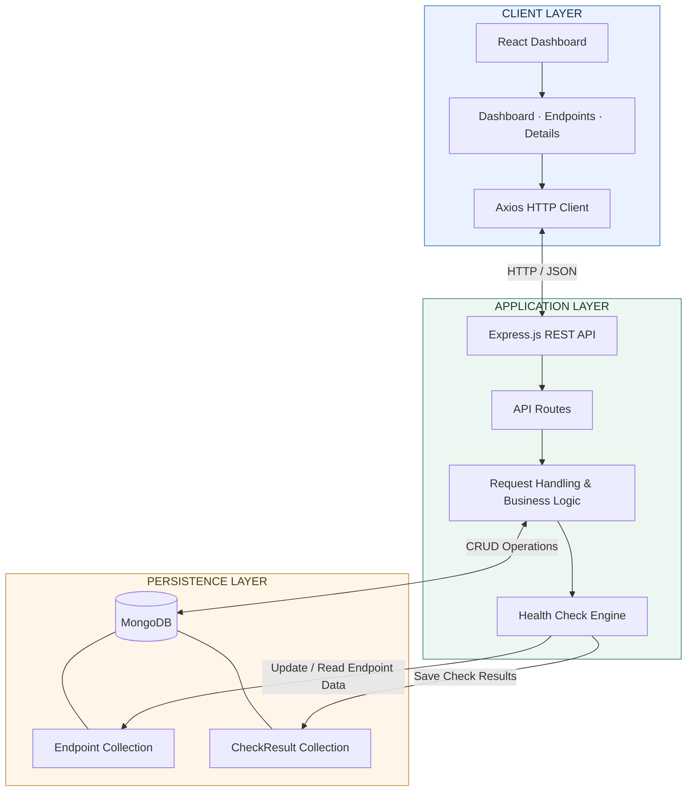
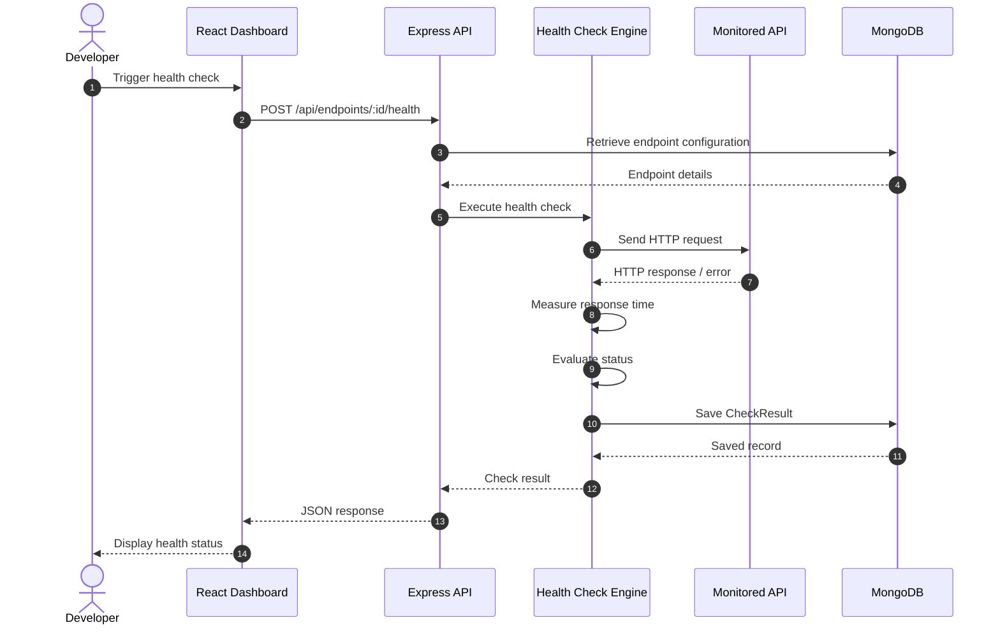
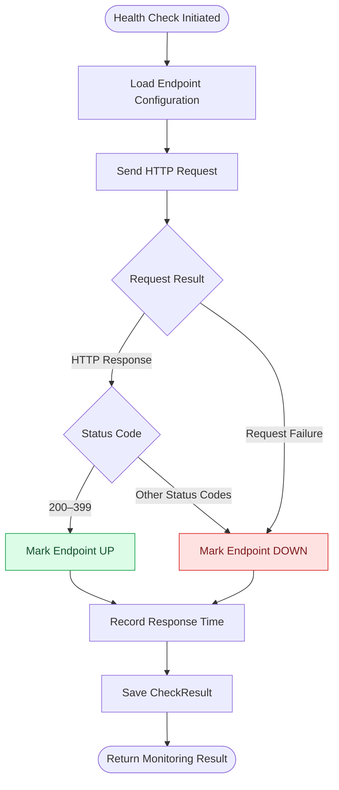
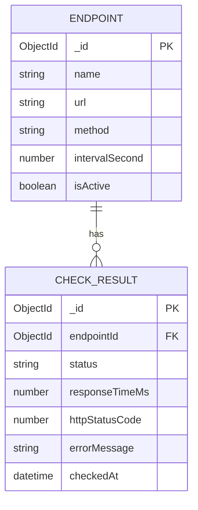

# API Sentinel

### Monitor. Detect. Understand.

**A real-time API monitoring platform that helps developers track endpoint health, measure response times, detect failures, and maintain a history of API performance.**

<p align="center">
  <a href="YOUR_LIVE_URL">Live Demo ↗</a>
</p>

<p align="center">
  
  
  
  
  
  
</p>

---

## Overview

API Sentinel is an API monitoring and observability platform designed to make endpoint health visible and actionable.

When an API becomes slow, returns an unexpected status code, or stops responding, developers need a reliable way to identify the problem and understand its history.

API Sentinel provides a centralized dashboard to:

- Register and manage API endpoints.
- Trigger health checks and inspect their results.
- Identify healthy and failing endpoints.
- Measure API response times.
- Review historical health-check records.
- Track endpoint uptime and performance trends.

Rather than manually testing endpoints one by one, API Sentinel brings monitoring information into a single interface.

## Product Architecture

The application follows a client-server architecture built around React, Express, and MongoDB.

### High-level system architecture



### Core monitoring workflow

The health-check process evaluates an endpoint by sending an HTTP request, measuring its response time, interpreting the result, and persisting the check record.



### Health evaluation logic



## Features

| Feature | Description |
|---|---|
| Endpoint Management | Create, view, update, and delete monitored endpoints. |
| Health Checks | Execute HTTP health checks against registered endpoints. |
| Status Detection | Classify responses as UP or DOWN based on the HTTP result. |
| Response Time Tracking | Measure the time taken by monitored APIs to respond. |
| Monitoring History | Store and review historical health-check records. |
| Uptime Information | Retrieve endpoint uptime information. |
| Dashboard | Centralized overview of endpoint health and performance. |
| Endpoint Details | Inspect individual endpoint configuration and monitoring information. |

## Technology Stack

### Frontend

- **React.js** — Component-based user interface.
- **Vite** — Frontend development and build tooling.
- **React Router DOM** — Client-side navigation.
- **Axios** — HTTP communication with the backend.
- **CSS** — Responsive dashboard styling.

### Backend

- **Node.js** — JavaScript runtime.
- **Express.js** — REST API and request handling.
- **Mongoose** — MongoDB object modeling.
- **Axios** — HTTP requests to monitored endpoints.

### Database

- **MongoDB** — Persistent storage for endpoint configurations and health-check records.

## Data Model

API Sentinel uses two central data entities.

### Endpoint

Represents an API registered for monitoring.

| Field | Description |
|---|---|
| name | Display name of the endpoint |
| url | Target API URL |
| method | HTTP request method |
| intervalSecond | Configured check interval |
| isActive | Whether the endpoint is active |

### CheckResult

Represents an individual health-check execution.

| Field | Description |
|---|---|
| endpointId | Reference to the monitored endpoint |
| status | UP or DOWN |
| responseTimeMs | Measured response time |
| httpStatusCode | Returned HTTP status code |
| errorMessage | Error information, when available |
| checkedAt | Time of the health check |

### Entity relationship



## API Reference

The backend exposes REST endpoints for managing monitored APIs and retrieving monitoring information.

| Method | Endpoint | Description |
|---|---|---|
| GET | `/api/health` | Check backend availability |
| POST | `/api/endpoints` | Create an endpoint |
| GET | `/api/endpoints` | Retrieve endpoints |
| GET | `/api/endpoints/:id` | Retrieve endpoint details |
| PATCH | `/api/endpoints/:id` | Update an endpoint |
| DELETE | `/api/endpoints/:id` | Delete an endpoint |
| POST | `/api/endpoints/:id/health` | Execute a health check |
| GET | `/api/endpoints/:id/history` | Retrieve check history |
| GET | `/api/endpoints/:id/uptime` | Retrieve uptime information |

## Project Structure

```text
api-sentinel/
│
├── backend/
│   ├── models/
│   │   ├── Endpoint.js
│   │   └── CheckResult.js
│   │
│   ├── routes/
│   ├── controllers/
│   ├── middleware/
│   ├── config/
│   ├── server.js
│   └── package.json
│
├── frontend/
│   ├── public/
│   ├── src/
│   │   ├── components/
│   │   ├── pages/
│   │   ├── services/
│   │   ├── App.jsx
│   │   └── main.jsx
│   │
│   ├── index.html
│   └── package.json
│
└── README.md
```

*The tree illustrates the intended separation of frontend and backend responsibilities. Adjust folder names to match the final repository.*

## Getting Started

Follow these steps to run API Sentinel locally.

### Prerequisites

- Node.js
- npm
- MongoDB instance
- Git

### 1. Clone the repository

```bash
git clone YOUR_GITHUB_REPOSITORY_URL
cd api-sentinel
```

### 2. Configure the backend

```bash
cd backend
npm install
```

Create a `.env` file using the environment variable names expected by your backend configuration.

Example:

```env
PORT=8080
MONGO_URI=your_mongodb_connection_string
```

### 3. Start the backend

```bash
npm start
```

### 4. Configure the frontend

Open another terminal:

```bash
cd frontend
npm install
```

### 5. Start the frontend

```bash
npm run dev
```

Open the local development URL displayed by Vite in your terminal.

## Example Health Check Result

A successful API health check can return information in this general form:

```json
{
  "success": true,
  "data": {
    "status": "UP",
    "responseTimeMs": 142,
    "httpStatusCode": 200,
    "checkedAt": "2026-10-30T12:00:00.000Z"
  }
}
```

*Illustrative response structure. Actual response fields depend on the backend implementation.*

## Engineering Considerations

API Sentinel is built around a few important engineering principles:

- **Separation of concerns:** The React client, Express application, monitoring logic, and persistence layer have distinct responsibilities.
- **Persistence:** Health-check records are stored so that previous results can be inspected.
- **Failure handling:** HTTP failures and request errors are considered when evaluating endpoint health.
- **Performance visibility:** Response-time measurements help identify slow APIs.
- **Extensibility:** The monitoring model can be extended with additional metrics and alerting capabilities.

## Future Improvements

Potential directions for further development:

- Automated recurring monitoring with a reliable scheduling mechanism.
- Email and notification-based incident alerts.
- Configurable timeout and retry policies.
- Response-time percentile analytics.
- Historical uptime and availability reports.
- Multi-user workspaces and role-based access.
- Monitoring of authenticated APIs.
- Exportable monitoring reports.

## Screenshots

Add actual screenshots of the completed application here.

| Dashboard | Endpoint Management |
|---|---|
|  |  |

| Endpoint Details | Health History |
|---|---|
|  |  |

## Contributing

Contributions, suggestions, and improvements are welcome.

1. Fork the repository.
2. Create a feature branch.
3. Commit your changes.
4. Open a pull request describing your changes.

## License

This project is available under the MIT License. See the `LICENSE` file for details.

---

<p align="center">
  **API Sentinel**
  <br/>
  Making API health visible, one endpoint at a time.
</p>
