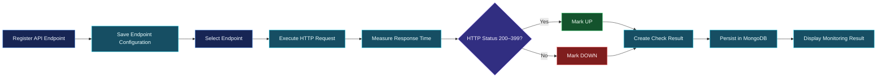
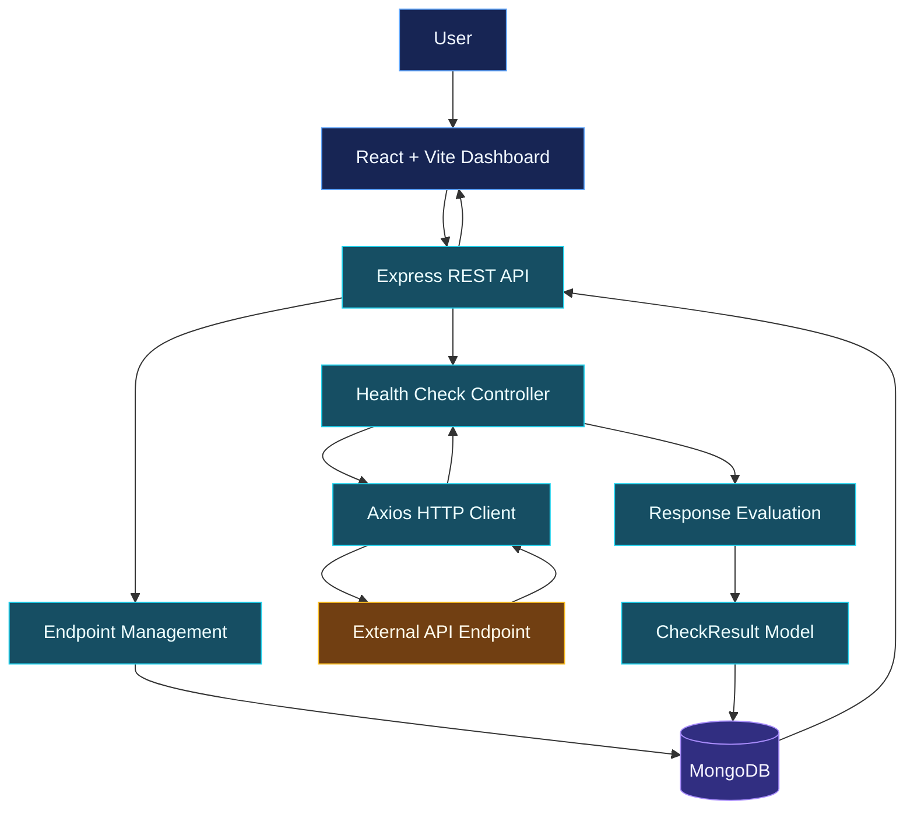
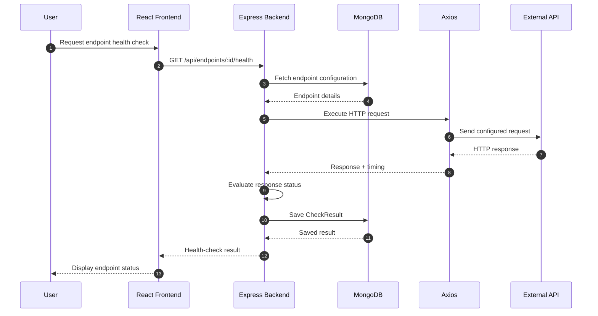
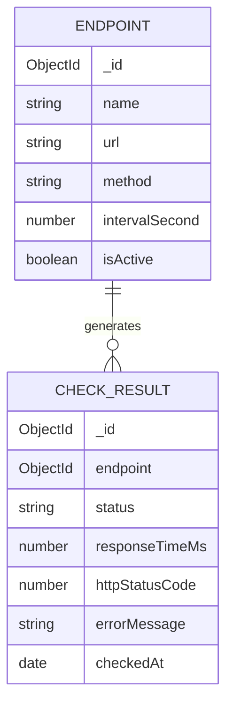

 <div align="center">


<br/>

<p>
<strong>A centralized API monitoring platform built to track endpoint health, measure response times, and maintain a history of monitoring results.</strong>
</p>

<p>


</p>

<p>


</p>

<em>Register endpoints. Execute health checks. Understand API reliability.</em>

<br/>

**[Live Application](YOUR_LIVE_URL_HERE)**

</div>

---

## What is API Sentinel?

**API Sentinel** is an API monitoring and observability platform designed to help developers monitor the availability and performance of their API endpoints from a centralized dashboard.

Instead of manually sending requests to individual endpoints, API Sentinel provides a structured way to register APIs, execute health checks, measure response times, and store monitoring results.

The platform evaluates HTTP responses and classifies endpoints based on their availability.

The central idea is simple:

> **Know when an API is healthy, identify when it fails, and understand how it performs over time.**

## The problem

Modern applications depend on multiple APIs and external services. A single unavailable or slow endpoint can affect an entire application.

Developers often need to manually test endpoints, inspect responses, and repeat these checks to understand service availability.

API Sentinel aims to simplify this process through:

- **Centralized monitoring:** Maintain multiple API endpoint configurations in one place.
- **Health checks:** Execute HTTP requests against registered endpoints.
- **Response-time measurement:** Measure how long an endpoint takes to respond.
- **Failure detection:** Identify unsuccessful HTTP responses and request errors.
- **Monitoring history:** Persist individual health-check results for later analysis.
- **Endpoint configuration:** Control monitoring settings and endpoint activation.

## Product workflow



## System architecture

API Sentinel uses a client-server architecture with a React frontend, an Express backend, and MongoDB for persistent storage.

The backend coordinates endpoint configuration, health-check execution, HTTP response evaluation, and monitoring-result persistence.



### Main components

| Component | Responsibility |
|---|---|
| **React frontend** | Monitoring dashboard and user interface. |
| **Vite** | Frontend development and build tooling. |
| **Express backend** | REST API and application request handling. |
| **Endpoint model** | Stores endpoint configuration and monitoring settings. |
| **Health-check controller** | Executes HTTP checks and evaluates responses. |
| **Axios** | Sends HTTP requests to monitored endpoints. |
| **CheckResult model** | Stores the outcome of each health check. |
| **MongoDB** | Persists endpoint configurations and check history. |

## Health-check execution

The health-check engine is responsible for evaluating the availability of a configured endpoint.

When a health-check request is received, the backend retrieves the endpoint configuration and uses Axios to execute the configured HTTP method.

The implementation uses a **5-second request timeout** and measures response duration in milliseconds.



### Health classification

The current implementation uses the following classification:

| Condition | Result |
|---|---|
| HTTP status `200–399` | `UP` |
| HTTP status outside `200–399` | `DOWN` |
| Request timeout | `DOWN` |
| Network or request error | `DOWN` |

Each execution records the status, response time, HTTP status code when available, error message, and check timestamp.

## Core features

### 01 / Endpoint configuration

Register API endpoints with their monitoring configuration.

- Endpoint name
- Target URL
- HTTP method
- Monitoring interval in seconds
- Active/inactive state

### 02 / HTTP health checks

Execute HTTP requests against configured endpoints using Axios.

- Configured HTTP method
- Request timeout
- HTTP response evaluation
- Error handling
- Endpoint health classification

### 03 / Response-time measurement

Measure the duration of each health-check request in milliseconds.

This measurement provides a foundation for identifying slow endpoints and understanding performance changes.

### 04 / Failure detection

Identify endpoints that return unsuccessful HTTP responses or fail to respond within the configured timeout.

### 05 / Persistent monitoring results

Save individual check results in MongoDB, allowing monitoring history to be retained rather than relying only on temporary application state.

## Data architecture

API Sentinel uses two main data models to represent monitored endpoints and their health-check results.

### Endpoint model

Stores the configuration of an API endpoint.

| Field | Description |
|---|---|
| `name` | Name of the endpoint |
| `url` | Target API URL |
| `method` | HTTP request method |
| `intervalSecond` | Configured monitoring interval |
| `isActive` | Whether the endpoint is active |

### CheckResult model

Stores the outcome of an individual health-check execution.

| Field | Description |
|---|---|
| `endpoint` | Reference to the monitored endpoint |
| `status` | `UP` or `DOWN` |
| `responseTimeMs` | Response duration in milliseconds |
| `httpStatusCode` | HTTP response status code |
| `errorMessage` | Error information when applicable |
| `checkedAt` | Timestamp of the check |

### Entity relationship



## API reference

Base URL:

```text
http://localhost:5000
```

### Server health

| Method | Route | Description |
|---|---|---|
| `GET` | `/api/health` | Checks whether the backend server is running. |

Example response:

```json
{
  "success": true,
  "message": "Api sentinel server is running"
}
```

### Endpoint health check

| Method | Route | Description |
|---|---|---|
| `GET` | `/api/endpoints/:id/health` | Executes a health check for a configured endpoint. |

Example request:

```http
GET /api/endpoints/ENDPOINT_ID/health
```

The backend retrieves the endpoint configuration, executes the HTTP request, evaluates the response, and stores the result.

*Additional routes can be documented here as the backend API surface is finalized.*

## Project structure

The application separates frontend and backend responsibilities.

```text
api-sentinel/
│
├── backend/
│   ├── models/
│   │   ├── Endpoint.js
│   │   └── CheckResult.js
│   │
│   ├── server.js
│   ├── .env
│   └── package.json
│
├── frontend/
│   ├── src/
│   │   ├── components/
│   │   ├── pages/
│   │   ├── App.jsx
│   │   └── main.jsx
│   │
│   ├── public/
│   ├── package.json
│   └── index.html
│
└── README.md
```

*This is a logical overview. Adjust the tree if your current repository contains additional folders or different file locations.*

## Development setup

### Prerequisites

- Node.js
- npm
- MongoDB local instance or MongoDB Atlas
- Git

### 1. Clone the repository

```bash
git clone YOUR_GITHUB_REPOSITORY_URL
cd api-sentinel
```

### 2. Configure the backend

```bash
cd backend
npm install
```

Create a `.env` file:

```env
PORT=5000
MONGO_URI=your_mongodb_connection_string
```

Start the backend using the start script configured in `package.json`:

```bash
npm start
```

### 3. Configure the frontend

Open another terminal:

```bash
cd frontend
npm install
npm run dev
```

### 4. Open the application

Open the local development URL displayed by Vite.

Verify the backend:

```text
http://localhost:5000/api/health
```

## Engineering decisions

| Decision | Engineering reasoning |
|---|---|
| React + Vite | Component-based frontend with fast development tooling. |
| Express REST API | Lightweight backend request handling. |
| MongoDB + Mongoose | Persistent storage for endpoint configurations and monitoring results. |
| Axios | HTTP request execution and timeout configuration. |
| 5-second timeout | Prevents a health-check request from waiting indefinitely. |
| `200–399` as `UP` | Treats successful and redirect HTTP responses as reachable. |
| Separate check records | Preserves individual monitoring outcomes for historical analysis. |

### Important implementation considerations

**Timeout handling**

A target endpoint may become unresponsive. A finite timeout prevents the monitoring request from waiting indefinitely.

**Response classification**

A response is considered `UP` when its HTTP status code is between 200 and 399. Other HTTP responses and request errors are classified as `DOWN`.

**Monitoring history**

Saving each check result provides the data foundation for historical status views, response-time trends, and uptime calculations.

## Roadmap

The following enhancements represent potential future development, not completed functionality.

| Phase | Enhancement | Status |
|---|---|---|
| 01 | Endpoint configuration and persistence | Implemented |
| 02 | HTTP health-check execution | Implemented |
| 03 | Response-time measurement | Implemented |
| 04 | Health classification and error handling | Implemented |
| 05 | Persistent check-result history | Implemented |
| 06 | Automated recurring health-check scheduler | Planned |
| 07 | Uptime percentage and reliability metrics | Planned |
| 08 | Historical response-time visualizations | Planned |
| 09 | Failure notifications and alerting | Planned |
| 10 | Expanded automated testing and evaluation | Planned |

<details>
<summary><strong>Engineering checklist</strong></summary>

- [x] Create endpoint and check-result data models
- [x] Configure Express backend
- [x] Connect MongoDB using Mongoose
- [x] Execute HTTP health checks using Axios
- [x] Configure request timeout handling
- [x] Measure response time
- [x] Classify endpoint health
- [x] Persist health-check results
- [ ] Implement automated recurring checks
- [ ] Calculate historical uptime
- [ ] Build response-time trend analytics
- [ ] Implement alert notifications
- [ ] Expand automated testing

</details>

## Reliability and limitations

- A successful health check confirms that an endpoint responded according to the configured HTTP status rules; it does not guarantee that every underlying business operation works correctly.
- Response-time measurements can vary with network conditions, server load, and target availability.
- A timeout indicates that the request did not complete within the configured period, not necessarily that the target service is permanently unavailable.
- Monitoring history depends on successful persistence of check results.
- Automated scheduling, alerting, and uptime analytics should only be considered available once implemented and verified.

## Contributing and feedback

API Sentinel is an engineering project focused on API monitoring, backend development, and service reliability.

Suggestions and feedback regarding endpoint monitoring, health classification, error handling, and observability are welcome.

When reporting an issue, include:

- The endpoint configuration (without private credentials).
- Expected behavior.
- Actual behavior.
- Relevant error output.
- Steps to reproduce the issue.

Never commit API keys, database credentials, or other private configuration values.

---

<div align="center">

**API Sentinel — visibility is the first step toward reliability.**

<sub>Designed and developed by
<a href="https://github.com/Sarthaktanpure">Sarthak Tanpure</a></sub>

<br/><br/>

<em>Monitor intelligently. Detect failures. Build reliable systems.</em>

<br/><br/>


</div>
